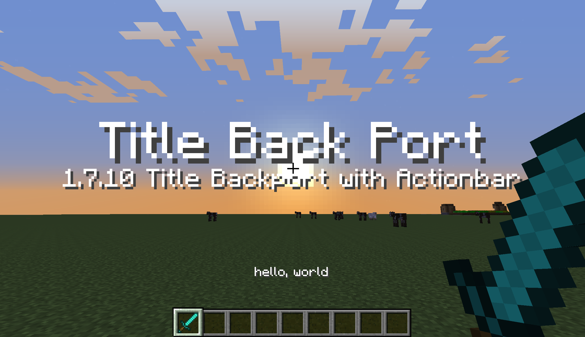

# mc-oneseven-title (TitleBackport)

Minecraft 1.7.10 (Forge) クライアント向けに、1.8 以降で導入された **タイトル (Title)**、**サブタイトル (Subtitle)**、**アクションバー (Action Bar)** をバックポートする Mod & サーバープラグインです。



---

## 🌟 主な特徴

- **完全なタイトル機能のバックポート**:
  - タイトル (Title: 画面中央大文字)
  - サブタイトル (Subtitle: タイトル下部中文字)
  - アクションバー (Action Bar: ホットバー上部)
  - フェードイン / 表示時間 / フェードアウト (Times) のスムーズなアニメーション描画
  - タイトル消去 (Clear) および設定初期化 (Reset)
- **広範なサーバーバージョン互換性**:
  - **Spigot / Paper 1.8.8 〜 1.21.x** の全バージョンに対応。
  - ViaVersion / ViaRewind を導入した Velocity / BungeeCord プロキシ環境、およびバックエンド単体環境に対応。
- **プラグインパケットの自動検知**:
  - サーバーのバニラ `/title` コマンドはもちろん、他プラグインが送出するタイトルやアクションバー（Paper Adventure API、Spigot API、NMS直接送信パケット）を Netty レベルで自動インターセプトして 1.7.10 向けに中継。
- **1.7.10 シングルプレイ対応**:
  - クライアント単体（シングルプレイ）でも 1.8 と同様の `/title` コマンドが動作。
  - カラーコード（`&`）および JSON テキストコンポーネント（`{"text":"..."}`）の双方に対応。

---

## 🔧 動作要件

| 環境 | 要件 |
| :--- | :--- |
| **クライアント** | Minecraft 1.7.10 + Minecraft Forge (10.13.4.1614 推奨) |
| **サーバー (マルチプレイ)** | Spigot / Paper (1.8.8 〜 1.21.x) |
| **プロキシ / 互換レイヤー** | ViaVersion + ViaRewind (1.7.10 クライアントの接続許可環境) |

---

## 📦 導入方法

### 1. クライアント側 (Forge Mod)
1. ビルド成果物 `titlebackport-1.0.0.jar` をダウンロードまたはビルドします。
2. Minecraft 1.7.10 の `.minecraft/mods` フォルダに配置して起動します。

### 2. サーバー側 (Spigot / Paper プラグイン)
1. ビルド成果物 `titlebackport-plugin-1.0.0.jar` をダウンロードまたはビルドします。
2. サーバーの `plugins` フォルダに配置してサーバーを再起動します。

> **Note**: ViaVersion / ViaRewind がサーバーまたはプロキシ（Velocity 等）に導入されている環境で、1.7.10 クライアントが接続した際に自動的にタイトルが中継されます。

---

## 🎮 コマンド仕様

1.7.10 シングルプレイ、および 1.8+ サーバー上で使用可能な `/title` コマンドです。

```text
/title <player> title <text | json>
/title <player> subtitle <text | json>
/title <player> actionbar <text | json>
/title <player> times <fadeIn> <stay> <fadeOut>
/title <player> clear
/title <player> reset
```

### 使用例
- **通常のタイトル表示**:
  ```text
  /title @p title "Title Back Port"
  /title @p subtitle "1.7.10 Title Backport with Actionbar"
  ```
- **アクションバー表示**:
  ```text
  /title @p actionbar "hello, world"
  ```
- **表示時間の設定 (tick単位)**:
  ```text
  /title @p times 20 60 20
  ```
- **カラーコード・JSON コンポーネント**:
  ```text
  /title @p title &a&lSuccess!
  /title @p title {"text":"Hello World","color":"gold","bold":true}
  ```

---

## 🛠 ビルド方法

プロジェクトルートで以下の Gradle コマンドを実行します。

```bash
# Mod および プラグインを一括ビルド (build/libs に出力)
./gradlew buildAll

# プラグインのみビルド
./gradlew buildPlugin

# Mod のみビルド
./gradlew :mod:build
```

### ビルド成果物 (`build/libs/`)
- `titlebackport-1.0.0.jar`: Minecraft 1.7.10 Forge クライアント用 Mod
- `titlebackport-plugin-1.0.0.jar`: Spigot / Paper サーバー用プラグイン

---

## 📄 ライセンス

本プロジェクトは [MIT License](LICENSE) の下で公開されています。

- **Author**: Shin ([Shin-Ideal](https://github.com/Shin-Ideal))
